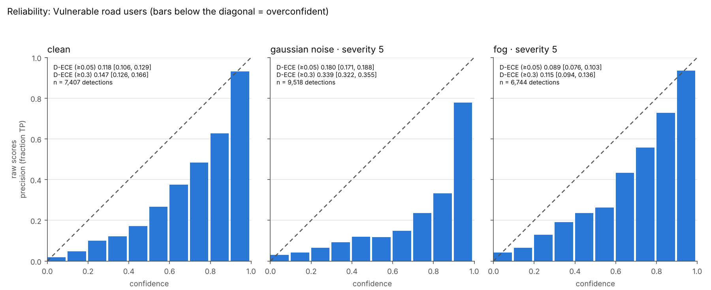
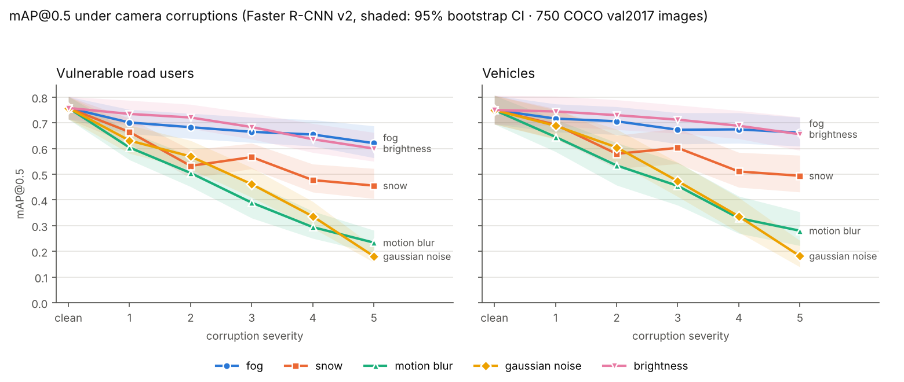
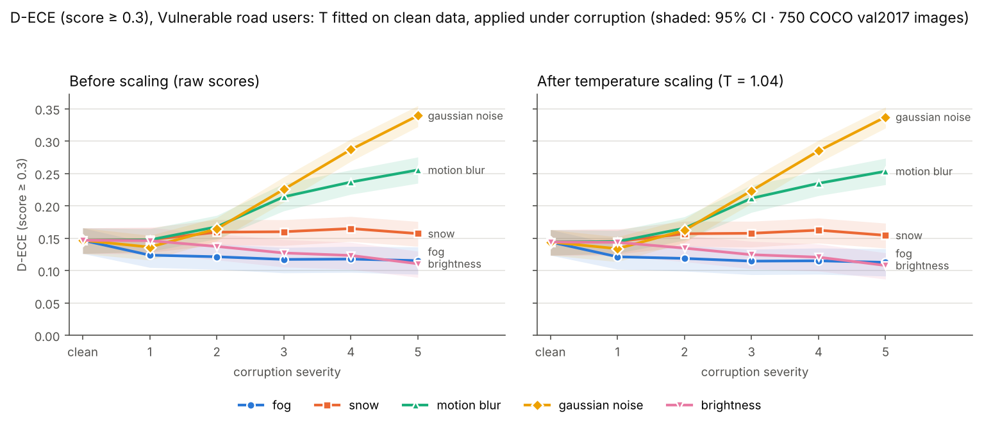

# Detector Reliability Under Corruption

[](https://github.com/dhrgam79/detector-reliability/actions/workflows/ci.yml)
[](https://colab.research.google.com/github/dhrgam79/detector-reliability/blob/main/notebooks/colab_quickstart.ipynb)

A pretrained object detector (torchvision Faster R-CNN ResNet-50-FPN v2, COCO weights) is evaluated on
images degraded by camera corruptions (fog, snow, motion blur, Gaussian noise, brightness) at five
severity levels. For each condition we measure detection accuracy (COCO mAP) and confidence calibration
(D-ECE, reliability diagrams), with image-level bootstrap confidence intervals. We then apply post-hoc
temperature scaling fitted on clean data and test whether it holds under shift. Results are read in
SOTIF (ISO 21448) terms: corruptions as **triggering conditions**, miscalibrated confidence as a
**hazardous behaviour of the intended functionality**.



## Key results

All numbers are from [`results/summary.csv`](results/summary.csv) (750 COCO val2017 evaluation images,
95% image-level bootstrap CIs, 1000 resamples; differences vs clean are paired).
VRU = vulnerable road users (person, bicycle, motorcycle; 2,970 GT instances).

1. **Every corruption costs accuracy, by very different amounts.** VRU mAP@0.5 falls from
   **0.758** [0.715, 0.802] clean to 0.181 under Gaussian noise severity 5 (−0.578 [−0.622, −0.530])
   and 0.234 under motion blur (−0.524), but only to 0.621 under fog (−0.137 [−0.173, −0.093]) and
   0.600 under brightness (−0.158).
2. **Calibration does not degrade uniformly; there are two distinct failure modes.**
   - *Confident errors* (noise, motion blur): VRU D-ECE at the 0.3 operating point rises from
     **0.147** [0.126, 0.166] to **0.339** (+0.193 [+0.171, +0.214]) under noise-5 and to 0.255
     (+0.109 [+0.085, +0.132]) under blur-5. VRU detections reported at ~97% confidence are correct
     **78%** of the time under noise-5 (93% clean).
   - *Silent misses* (fog, brightness): D-ECE **improves** (fog-5 −0.031 [−0.044, −0.018],
     brightness-5 −0.036 [−0.050, −0.023]) while recall drops. The detections that remain are, if
     anything, less overconfident; the hazard is what is no longer detected.
   - Snow sits between the two: no significant change for VRU (+0.010 [−0.007, +0.027]), but a
     significant increase for vehicles (+0.095 [+0.064, +0.128]).
3. **The clean detector is already overconfident at every confidence level**, including the lowest
   bin (VRU: 2% true positives at mean confidence 7%).
4. **Temperature scaling fitted on clean data does essentially nothing.** The fitted temperature is
   T = 1.043 (NLL 0.3677 → 0.3674 on 3,145 calibration detections). D-ECE at the 0.3 threshold
   improves by only 0.002–0.003 in every condition, and gets slightly worse at the 0.05 threshold
   (−0.002 to −0.005). Reason: a temperature is symmetric around 0.5. Because the detector is
   overconfident both above and below 0.5, softening helps the high scores and hurts the low ones, and
   the fit settles at T ≈ 1. The miscalibration is an *offset*, which a single temperature cannot fix.

| Figure | |
|---|---|
|  |  |

## SOTIF interpretation

**Triggering conditions.** Each corruption stands in for an environmental or sensor condition that can
push the perception function outside its validated envelope: fog and snow for weather, motion blur for
ego-motion or long exposure in low light, Gaussian noise for sensor noise at high gain, brightness for
over-exposure (glare, tunnel exit).

**Two hazardous behaviours, not one.**

- *Confident errors* (noise, blur, and snow for vehicles). The detector keeps producing high-confidence
  detections, but more of them are wrong. Downstream fusion and planning typically weight or gate objects
  by confidence, so a false pedestrian at 0.97 is treated as real (phantom braking), and a real one
  mislocalised at 0.97 is trusted. A confidence- or calibration-based runtime monitor *can* see this
  shift, if it monitors calibration online.
- *Silent misses* (fog, brightness). The detector loses objects while what it still reports looks
  well-calibrated. D-ECE is computed only over detections, so it is structurally blind to false
  negatives, and so is any monitor that watches only confidence. Detecting this needs a different
  signal: input-quality monitoring (contrast, visibility estimation), cross-sensor consistency
  (radar/lidar tracks with no camera confirmation), or expected-object-count priors.

**What a runtime monitor needs, given these results.**
1. A per-condition view: a single global calibration figure hides both effects, because the two
   failure modes move D-ECE in opposite directions.
2. A false-negative channel independent of detector confidence.
3. Recalibration that is condition-aware: a correction fitted on clean data (here, T = 1.04) does not
   transfer, and even a better clean-data fit cannot anticipate corruption-specific overconfidence.

**Evidence sufficiency.** Claims are made only where the data support them:

| Group (evaluation split) | GT instances | Clean mAP@0.5 (95% CI) | Clean D-ECE@0.3 (95% CI) | Used for claims |
|---|---:|---|---|---|
| Vulnerable road users | 2,970 | 0.758 [0.715, 0.802] | 0.147 [0.126, 0.166] | yes (headline) |
| Vehicles | 641 | 0.750 [0.695, 0.807] | 0.222 [0.191, 0.253] | yes |
| Infrastructure (traffic light, stop sign) | 180 | 0.610 [0.505, 0.714] | 0.278 [0.231, 0.324] | group-level only; stop sign alone has 20 instances |
| All 80 COCO classes | 7,006 | 0.642 (no CI*) | 0.226 [0.214, 0.237] | comparability only |

\*Bootstrap CIs for mAP are computed for the 8 driving classes only, to stay within the runtime
budget ([`docs/DECISIONS.md`](docs/DECISIONS.md), D51). Person makes up 72% of driving-class instances
(2,747 of 3,791),
so the class-averaged 8-class mAP is noisy (it moved 17 points between two random 250-image halves);
the headline is therefore VRU, not the 8-class average.

## Method

| | |
|---|---|
| Model | `fasterrcnn_resnet50_fpn_v2`, torchvision COCO_V1 weights; score threshold 0.05, top 100 detections per image; fp16 autocast on GPU |
| Data | COCO val2017, images containing ≥ 1 non-crowd driving-class object (3,028 eligible); seeded draw of 1,000 → 250 calibration / 750 evaluation; the image ids are committed in [`results/split.json`](results/split.json) and verified on every run |
| Corruptions | fog, snow, motion blur, Gaussian noise, brightness, severities 1–5; vendored from `imagecorruptions` 1.1.2 (Apache-2.0, fixed for NumPy 2, pixel-identical to the original for 4 of 5 corruptions, snow within ±1 intensity level), seeded per (image, corruption, severity) |
| Accuracy | COCO mAP@0.5 and mAP@[.5:.95] via pycocotools; bootstrap via a weighted reimplementation of `accumulate`, tested to 1e-12 against pycocotools |
| Matching | COCO protocol at IoU 0.5 (score-ordered, same class, best unmatched non-crowd GT; detections on crowd regions ignored); tested detection-by-detection against pycocotools |
| Calibration | D-ECE (Küppers et al. 2020, confidence-only), 10 equal-width bins on [0, 1], at score thresholds 0.05 (full range) and 0.3 (operating point) |
| Statistics | 1,000 image-level bootstrap resamples, shared by all conditions, so clean-vs-corrupted differences are paired |
| Fix | Temperature scaling on the confidence logit, `p' = sigmoid(logit(p) / T)`, one scalar T fitted by BCE on clean calibration-split detections; scores are only rescaled, so ranking, matching and mAP are unchanged (tested) |

Every design decision and its rationale is logged in [`docs/DECISIONS.md`](docs/DECISIONS.md).

## Reproduce

```bash
git clone https://github.com/dhrgam79/detector-reliability && cd detector-reliability
pip install -e ".[dev]"
python scripts/run_all.py        # data -> inference -> metrics -> calibration -> figures
pytest                           # CPU only; no network, data or model weights needed
```

`run_all.py` downloads only the COCO annotations and the 1,000 subset images. Detections are cached in
`results/cache/` with their configuration, so re-runs skip inference unless something relevant changed.
Figures can be regenerated from the committed CSVs alone with `detrel plots`. All parameters live in
[`configs/default.yaml`](configs/default.yaml).

Runtime on a free Colab T4: 40.2 min for the full sweep (34.7 min inference for 27 conditions,
5.6 min metrics), recorded in [`results/run_info.json`](results/run_info.json); the COCO images were
already on disk for that run. The [Colab notebook](notebooks/colab_quickstart.ipynb) runs the whole
pipeline from a fresh clone.

## Limitations

- **COCO is not driving data.** Images are everyday scenes filtered to driving-relevant classes;
  object scale, viewpoint and density differ from automotive cameras.
- **Synthetic corruptions are not real weather.** They are standard benchmark approximations
  (Hendrycks & Dietterich 2019; Michaelis et al. 2019). `imagecorruptions` has no rain; snow is the
  closest weather proxy.
- **One model**, one set of weights; the two failure modes may differ for other architectures.
- **One calibration method.** A single temperature, shown here to be structurally unable to correct
  an offset-type miscalibration.
- **D-ECE ignores false negatives** by construction; the "silent miss" mode is visible in mAP and
  recall, not in D-ECE.
- **fp16 inference.** Compared with fp32, mAP changed by ≤ 0.005 and mAP@0.5 by ≤ 0.002, except VRU
  mAP@0.5 on the calibration split (0.009). This exceeded a threshold set before the test and is
  recorded openly (D40).
- **Sample size.** 750 evaluation images; infrastructure results are group-level only, and the
  bootstrap captures variability over images, not over training runs.

## Next steps

1. **Platt scaling** (`sigmoid(a·z + b)`), the smallest change that can correct an offset, plus
   isotonic or histogram binning; per-class or per-group fits.
2. **Condition-aware recalibration and monitoring**: detect the triggering condition, then apply a
   correction fitted for it; add a false-negative channel independent of detector confidence.
3. **Driving datasets**: KITTI / nuScenes, and real adverse-weather data (e.g. ACDC).
4. **Runtime monitor**: a ROS 2 C++ node computing windowed calibration and input-quality signals
   online (Project 2).

## References

- F. Küppers, J. Kronenberger, A. Shantia, A. Haselhoff. *Multivariate Confidence Calibration for
  Object Detection.* CVPR Workshops, 2020.
- D. Hendrycks, T. Dietterich. *Benchmarking Neural Network Robustness to Common Corruptions and
  Perturbations.* ICLR, 2019.
- C. Michaelis et al. *Benchmarking Robustness in Object Detection: Autonomous Driving when Winter is
  Coming.* arXiv:1907.07484, 2019.
- C. Guo, G. Pleiss, Y. Sun, K. Q. Weinberger. *On Calibration of Modern Neural Networks.* ICML, 2017.
- ISO 21448:2022. *Road vehicles — Safety of the intended functionality.*

## License

MIT, see [LICENSE](LICENSE). The vendored corruption code in `src/detrel/_vendor/` is Apache-2.0
(license and change list included there).
